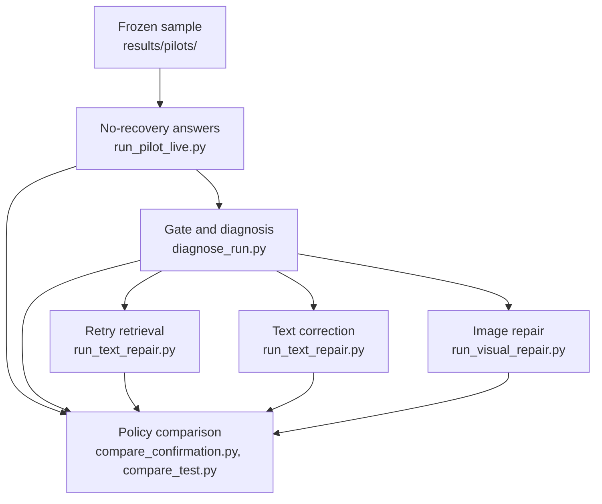

# Architecture

This page describes the pipeline the FAAR study ran, from the frozen sample to the comparison report. The results
are in the [FAAR study report](../reports/faar-study-report.md). The method settings are frozen in
[faar-vs-gated-preregistration.md](../research/faar-vs-gated-preregistration.md), section 14.

## The pipeline runs in five steps

Each answer and diagnosis step reads the previous step's run folder under `results/development/` and writes its own.
The comparison writes its report to `results/analysis/`. Only the answer
steps call the model. The gate, the diagnosis and the comparison run offline.

1. `scripts/data/build_pilot.py` builds a sample once from a config in `config/pilots/` and freezes it under
   `results/pilots/<pilot_id>/`. The runtime manifest holds what the pipeline may read. The evaluation manifest holds
   the gold answers, which only the scorer reads.
2. `scripts/experiments/run_pilot_live.py` retrieves the top 5 chunks for each question and asks the answer model
   for the initial answer. `src/faar/live_runner.py` keeps durable request and response records, so an interrupted
   run resumes without paying twice.
3. `scripts/experiments/diagnose_run.py` applies the gate and the diagnosis from `src/faar/diagnosis.py` to every
   question. It sends no request and reads no evaluation file.
4. Each repair runs on every flagged question, whatever the diagnosis chose. `scripts/experiments/run_text_repair.py`
   runs `retry_retrieval` and `correct_text` (`src/faar/text_repair.py`, `src/faar/symspell.py`).
   `scripts/experiments/run_visual_repair.py` runs `invoke_vlm` (`src/faar/visual_repair.py`).
5. The comparison script builds each policy from the saved answers, scores it and writes the report, the
   per-question scores and the statistics. It refuses to run if its output folder already exists.

Running every repair on every flagged question lets one set of model calls score all policies. FAAR takes the
repair its diagnosis chose. The gated image repair takes `invoke_vlm`. The random policy takes a repair drawn from a
hash of the question id. The best repair in hindsight takes whichever repair was right.

## The gate decides which questions get a repair

The gate `abstain-or-ocr-gap-v1+query_token_coverage<0.692308` flags a question when any of these holds:

- The initial answer abstained or found no evidence.
- The document has a page with empty or missing OCR text.
- Fewer than 69.2% of the question's words appear in the retrieved text.

`scripts/experiments/choose_confidence_gate.py` chose the last threshold on train data.

## The diagnosis picks one repair

`src/faar/diagnosis.py` checks the rules in this order and stops at the first match.

| Diagnosis | Fires when | Repair |
| --- | --- | --- |
| `missing_text` | No text evidence, or one of the up to 3 pages the image repair would show has empty or missing OCR text | `invoke_vlm` |
| `structural` | The top chunk shows at least one layout-damage signal | `invoke_vlm` |
| `word_level` | More than 10% of the top chunk's characters or tokens look like OCR noise | `correct_text` |
| `semantic` | None of the above | `retry_retrieval` |

## The three repairs answer again from new evidence

- `retry_retrieval` keeps the initial top 3 chunks and adds the 2 best chunks the first retrieval did not send
  (`keep-top3-add-next2-v1`).
- `correct_text` runs SymSpell spelling correction over the retrieved chunks.
- `invoke_vlm` sends the initial text plus images of up to 3 pages, chosen from the retrieved pages and then the
  pages with empty OCR text (150 DPI, JPEG quality 90).

Every repair uses the same answer model and prompt (`faar-answer-v2`) as the initial answer.

## Older code from the prototype

`src/faar/graph.py`, `src/faar/recovery.py` and the `faar-demo` command are the prototype controller from before the
study. They use a different gate and different repairs. The study did not run them.
